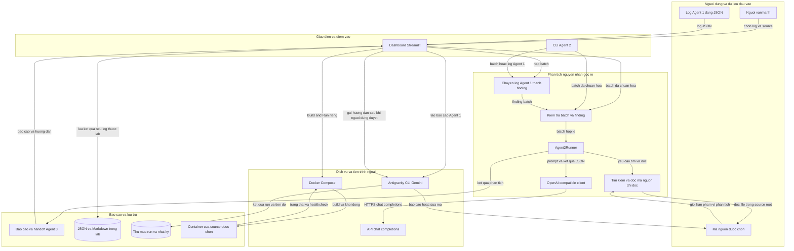
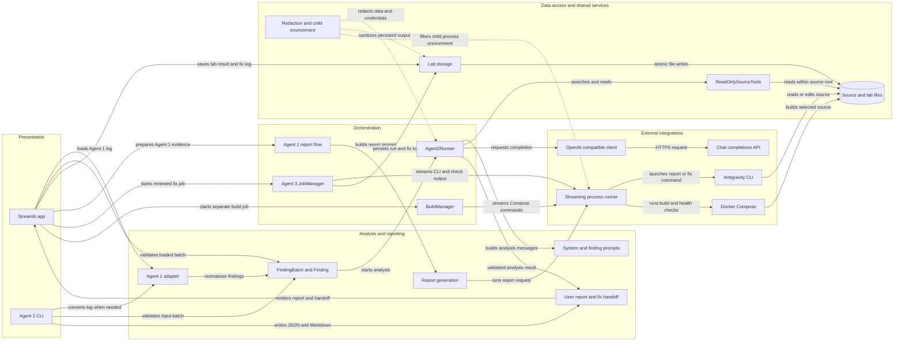

# Architecture Diagram

Agent 2 MVP là ứng dụng Python cung cấp giao diện Streamlit và CLI để phân tích nguyên nhân gốc rễ bảo mật trên mã nguồn đã chọn. Quy trình hỗ trợ nhập log Agent 1, phân tích chỉ đọc, tạo báo cáo và hướng dẫn sửa; việc sửa bằng Agent 3 và Build & Run là các luồng riêng, tùy chọn.

## Application Architecture

<!-- mermaid-checked: no \n, no em-dash/en-dash, no {} in labels, subgraphs are id["label"], arrows are -->|"label"|, all subgraphs closed by end, ids unique -->

### Technology Stack Summary

| Layer | Technology | Version | Purpose |
|---|---|---|---|
| Runtime | Python | >= 3.10 | Chạy ứng dụng, xử lý batch, CLI và worker nền |
| Giao diện | Streamlit | >= 1.55, < 2 | Cấu hình API, chọn log/source, hiển thị tiến độ và kết quả |
| Phân tích | Python modules trong `agent2` | 0.1.0 của dự án | Chuẩn hóa finding, điều phối vòng lặp Agent 2, kiểm tra schema |
| Truy cập mô hình Agent 2 | OpenAI-compatible chat completions qua `urllib` | Theo cấu hình | Gửi prompt và nhận kết quả phân tích; mặc định base URL là Cerebras |
| Công cụ đọc mã | `pathlib` và các hàm đọc/tìm kiếm nội bộ | Thư viện chuẩn Python | Tìm kiếm và đọc file giới hạn trong source root, không có quyền sửa |
| Agent 3 và báo cáo | Antigravity CLI `agy` với Gemini 3.1 Pro | `gemini-3.1-pro-high` | Viết báo cáo Agent 1 hoặc sửa source theo handoff đã được người dùng xem |
| Build tùy chọn | Docker Compose CLI | Theo cài đặt máy chủ | Build image, chạy dịch vụ source đã chọn và kiểm tra trạng thái/healthcheck |
| Lưu kết quả | JSON và Markdown trên filesystem | Không áp dụng | Lưu kết quả Agent 2 và hướng dẫn/nhật ký Agent 3 trong cấu trúc lab |

### Data Storage & External Services

Không có cơ sở dữ liệu ứng dụng hoặc cache chuyên dụng. Log Agent 1, batch và source được đọc từ filesystem; Agent 2 tạo kết quả có cấu trúc cùng báo cáo Markdown. Khi log được chọn từ thư mục export theo lab, kết quả và hướng dẫn sửa được lưu vào thư mục phân tích của lab; các run Agent 3 cũng ghi tiến độ/kết quả vào thư mục run cục bộ. Agent 2 gọi endpoint HTTPS tương thích OpenAI, mặc định cấu hình Cerebras. Báo cáo Agent 1 và Agent 3 gọi Antigravity CLI/Gemini bằng tiến trình con. Nút Build & Run độc lập gọi Docker Compose để khởi động source và kiểm tra dịch vụ.

### Key Architectural Decisions

- Mỗi finding được phân tích trong conversation/state riêng; kết quả `confirmed` cần có bằng chứng từ `read_file` trong chính lượt phân tích.
- Công cụ Agent 2 chỉ được tìm kiếm/đọc file nằm trong source root, đồng thời loại trừ thư mục và file nhạy cảm; Agent 2 chỉ tư vấn remediation, không tạo patch.
- Giao diện là luồng human-in-the-loop: người dùng xem và có thể chỉnh handoff trước khi gửi Agent 3; Build & Run là thao tác riêng, không mặc định chạy sau khi sửa.

## Component Relationships

<!-- mermaid-checked: no \n, no em-dash/en-dash, no {} in labels, subgraphs are id["label"], arrows are -->|"label"|, all subgraphs closed by end, ids unique -->

### Component Inventory

| Component | Layer | Type | Responsibility |
|---|---|---|---|
| `app.py` | Presentation | Streamlit dashboard | Nhận cấu hình, chọn log/source, chạy các luồng phân tích, hiển thị kết quả và tiến độ |
| `agent2.cli` | Presentation | CLI entry point | Đọc batch/log Agent 1, chạy Agent 2 và ghi JSON/Markdown đầu ra |
| `convert_agent1_to_batch` | Analysis and reporting | Adapter | Chuyển log Agent 1 thành finding batch, giữ bằng chứng đã quan sát và giới hạn dữ liệu |
| `FindingBatch`, `Finding` | Analysis and reporting | Schema/domain model | Chuẩn hóa, kiểm tra input và định dạng kết quả finding |
| `Agent2Runner` | Orchestration | Batch/agent loop | Chạy conversation riêng theo finding, điều phối tool, kiểm tra kết quả và áp dụng giới hạn |
| `SYSTEM_PROMPT`, `finding_prompt` | Analysis and reporting | Prompt definitions | Định nghĩa giao thức JSON, quy trình phân tích chỉ đọc và định dạng tiếng Việt |
| `ReadOnlySourceTools` | Data access | Source tools | Tìm kiếm và đọc file với kiểm soát phạm vi, extension, dung lượng và thư mục bị loại trừ |
| `OpenAICompatibleClient` | External integrations | HTTP client | Gọi API `/chat/completions`, xử lý lỗi và che thông tin nhạy cảm |
| `build_user_report`, `build_agent3_payload` | Analysis and reporting | Report/handoff renderer | Tạo báo cáo dễ đọc và nhóm các finding đã xác nhận thành hướng dẫn sửa |
| `agent1_report_input`, `generate_report_cli` | Orchestration | Report pipeline | Chuẩn bị bằng chứng Agent 1 và yêu cầu Gemini CLI viết báo cáo kiểm thử ban đầu |
| `JobManager`, `Job` | Orchestration | Background worker | Chạy Agent 3, truyền tiến độ CLI, ghi file thay đổi và tùy chọn kiểm tra |
| `BuildManager`, `BuildJob` | Orchestration | Background worker | Chạy Docker Compose trong source đã chọn, xác thực cấu hình và đợi healthcheck |
| `process_lines` | External integrations | Subprocess streaming utility | Gửi prompt qua stdin, đọc stdout/stderr theo luồng và giới hạn thời gian tiến trình |
| `save_analysis`, `save_fix_log` | Data access | Lab storage | Ghi kết quả và nhật ký theo lab bằng file JSON/Markdown |
| `redact_secrets`, `redact_data`, `child_process_env` | Data access | Security utilities | Che credential khỏi nội dung hiển thị/lưu và lọc biến môi trường tiến trình con |
| Chat completions API | External integrations | Model service | Sinh phản hồi cho phân tích Agent 2 qua API tương thích OpenAI |
| Antigravity CLI | External integrations | Gemini process | Viết báo cáo Agent 1 hoặc thực hiện sửa mã nguồn theo hướng dẫn người dùng duyệt |
| Docker Compose | External integrations | Build/runtime tool | Build và chạy dịch vụ của source được chọn, sau đó trả trạng thái container |
